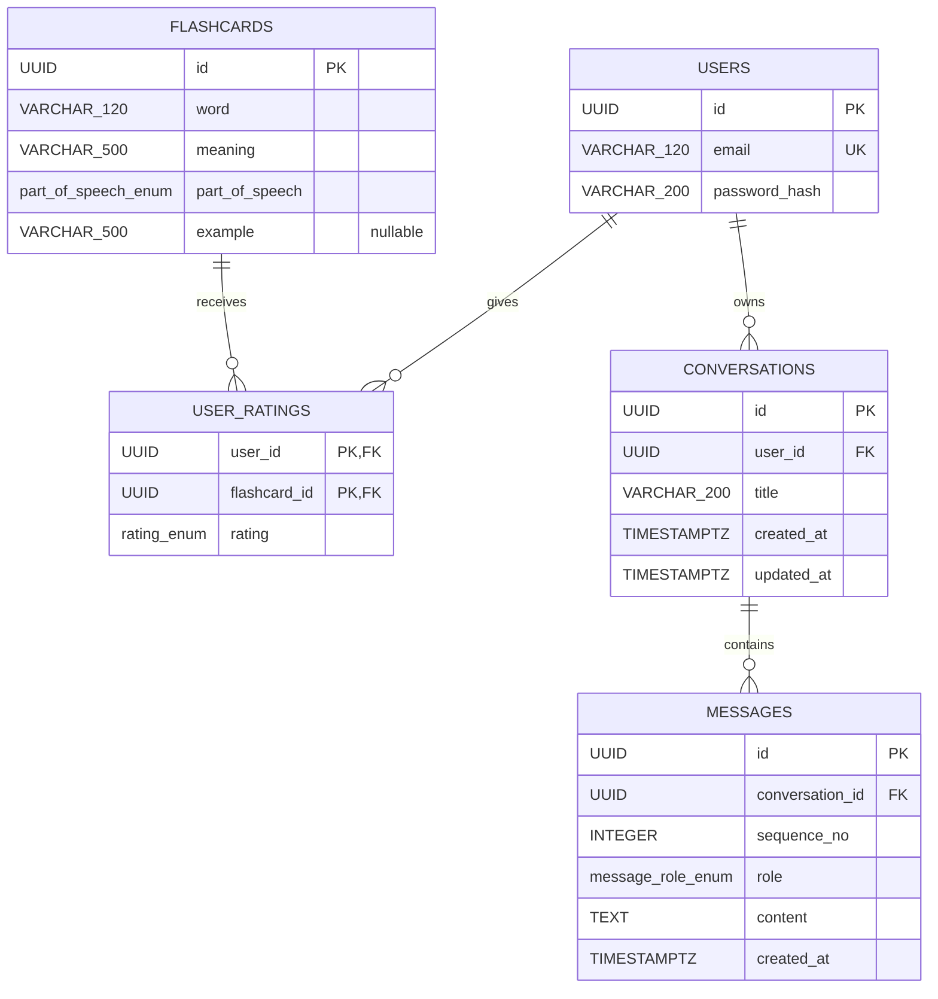

# Architecture

This document describes a target design of an application.

## 1. Design requirements

### Functional requirements

- Users can register with a valid email and matching passwords (minimum 8 characters), log in, and retrieve their own profile.
- Authenticated users can browse flashcards, filter by word, meaning, part of speech, and their own rating, sort by word, and paginate results.
- Authenticated users can create or change their rating for a flashcard.
- Authenticated users can request a learning session of up to 10 flashcards, selected by rating priority: hard, medium, easy, then unrated.
- Authenticated users can learn with AI powered Tutor through chat view. 
- AI powered Tutor has knowledge about Flashcards ratings that user left and uses this data in chat.
- AI powered Tutor can create new Flashcards basing on conversation with user.

### Non-functional requirements

- Reliability:
    * `GET /healthcheck` returns HTTP 503 when the database check fails.
- Security:
    * Vulnerabilities checks in pipelines

## 2. Data model

### Users (`users`)

| Column | Database type | Constraints |
|---|---|---|
| `id` | UUID | PK |
| `email` | VARCHAR(120) | NOT NULL, UNIQUE |
| `password_hash` | VARCHAR(200) | NOT NULL |

### Flashcards (`flashcards`)

| Column | Database type | Constraints |
|---|---|---|
| `id` | UUID | PK |
| `word` | VARCHAR(120) | NOT NULL |
| `meaning` | VARCHAR(500) | NOT NULL |
| `part_of_speech` | ENUM `part_of_speech_enum` | NOT NULL |
| `example` | VARCHAR(500) | NULL |

`part_of_speech_enum` values (database label → API value):

| Database enum value | API value |
|---|---|
| `NOUN` | `noun` |
| `VERB` | `verb` |
| `ADJECTIVE` | `adjective` |
| `ADVERB` | `adverb` |
| `PRONOUN` | `pronoun` |
| `PREPOSITION` | `preposition` |
| `CONJUNCTION` | `conjunction` |
| `INTERJECTION` | `interjection` |
| `NUMERAL` | `numeral` |
| `PROPER_NOUN` | `proper noun` |

### User ratings (`user_ratings`)

| Column | Database type | Constraints |
|---|---|---|
| `user_id` | UUID | PK, FK → `users.id` |
| `flashcard_id` | UUID | PK, FK → `flashcards.id` |
| `rating` | ENUM `rating_enum` | NOT NULL |

The composite primary key `(user_id, flashcard_id)` allows at most one rating per user for each flashcard.

`rating_enum` values (database enum label → API value):

| Database enum value | API value |
|---|---|
| `EASY` | `1` |
| `MEDIUM` | `2` |
| `HARD` | `3` |

The flashcard-list `rating` filter additionally accepts `0` to mean not rated; `0` is a filter option and is not stored in `user_ratings`.

### Conversations (`conversations`)

| Column | Database type | Constraints |
|---|---|---|
| `id` | UUID | PK |
| `user_id` | UUID | NOT NULL, FK → `users.id` |
| `title` | VARCHAR(200) | NULL |
| `created_at` | TIMESTAMPTZ | NOT NULL |
| `updated_at` | TIMESTAMPTZ | NOT NULL |

Each conversation belongs to one user.

### Messages (`messages`)

| Column | Database type | Constraints |
|---|---|---|
| `id` | UUID | PK |
| `conversation_id` | UUID | NOT NULL, FK → `conversations.id` |
| `sequence_no` | INTEGER | NOT NULL; unique with `conversation_id` |
| `role` | ENUM `message_role_enum` | NOT NULL |
| `content` | TEXT | NOT NULL |
| `created_at` | TIMESTAMPTZ | NOT NULL |

`message_role_enum` values:

| Enum value | Meaning |
|---|---|
| `USER` | Message written by the user |
| `ASSISTANT` | Response written by the AI tutor |

`sequence_no` provides deterministic message ordering within a conversation and has a unique constraint together with `conversation_id`. Deleting a conversation cascades to its messages.

### Relationships

The diagram shows the relationships between the data models. In particular, `user_ratings.user_id` references `users.id`, `conversations.user_id` references `users.id`, and `messages.conversation_id` references `conversations.id`.



## 3. API design

All paths below are relative to the API base URL configured by `VITE_API_URL`. Requests and responses are JSON unless stated otherwise. Successful response examples show the response body, not the HTTP status.

### Healthcheck

The healthcheck endpoint is public and verifies database connectivity.

| Method and path | Authentication | Request | Success response |
|---|---|---|---|
| `GET /healthcheck` | Public | None | `200`; `{"status":"healthy"}` |

If the database cannot be reached, it returns `503` with `{"detail":"Database unavailable"}`.

### Authentication

Registration and login are public. `GET /auth/me` requires an access JWT in the standard HTTP authorization header.

| Method and path | Authentication | Request | Success response |
|---|---|---|---|
| `POST /auth/register` | Public | JSON: `{"email":"learner@example.com","password_1":"...","password_2":"..."}` | `201`; `{"id":"<uuid>","email":"learner@example.com"}` |
| `POST /auth/login` | Public | Form URL-encoded OAuth2 fields `username` (email) and `password` | `200`; `{"access_token":"<jwt>","token_type":"bearer"}` |
| `GET /auth/me` | JWT required | None | `200`; `{"id":"<uuid>","email":"learner@example.com"}` |

Invalid input is rejected with `422`; missing or invalid credentials produce `401`. Registration also returns `400` if the email already exists or the passwords do not match. `/auth/me` returns `404` if the token refers to a user that no longer exists.

### Flashcards

All flashcard endpoints require an access JWT.

| Method and path | Request | Success response |
|---|---|---|
| `GET /flashcards/` | Query parameters below | `200`; paginated flashcard response below |
| `POST /flashcards/{flashcard_id}` | JSON: `{"rating":1}` (`1` easy, `2` medium, `3` hard) | `201`; `{"rating_changed":true}` or `{"rating_changed":false}` |
| `GET /flashcards/learning_session/` | None | `200`; array of flashcards, possibly empty |

#### Flashcard-list query parameters

| Parameter | Type and behavior |
|---|---|
| `page` | Integer, default `1`, minimum `1` |
| `page_size` | Integer, default `10`, range `1`–`50` |
| `order_by` | Optional `word` or `-word` (ascending or descending) |
| `word`, `meaning` | Optional string filter; substring match by default, surround a value with double quotes for exact match |
| `part_of_speech` | Optional `part_of_speech_enum` value |
| `rating` | Optional integer: `0` not rated, `1` easy, `2` medium, `3` hard |

`GET /flashcards/` paginated response:

```json
{
  "items": [
    {
      "id": "<uuid>",
      "word": "example",
      "meaning": "przykład",
      "part_of_speech": "noun",
      "example": "This is an example.",
      "rating": 1
    }
  ],
  "total": 1,
  "page": 1,
  "page_size": 10,
  "total_pages": 1,
  "has_next": false,
  "has_previous": false
}
```

`example` and `rating` may be `null`; `rating` is the requesting user's rating. An empty result has an empty `items` array and zero `total`/`total_pages`.

Invalid input is rejected with `422`; missing or invalid credentials produce `401`. Other failure responses are not exhaustively specified here.

### Conversations

These endpoints manage conversations owned by the authenticated user. All endpoints require a valid access JWT and only expose conversations belonging to that user.

| Method and path | Parameters / example request | Example success response |
|---|---|---|
| `GET /conversations` | Query: `page` (default `1`), `page_size` (default `20`, maximum `100`). Example: `/conversations?page=1&page_size=20` | `200`; paginated conversation summaries (example below) |
| `POST /conversations` | JSON: `{"title":"English practice"}`; `title` may be omitted or `null` | `201`; created conversation (example below) |
| `GET /conversations/{conversation_id}` | Path: `conversation_id` UUID. Example: `/conversations/550e8400-e29b-41d4-a716-446655440000` | `200`; conversation object |

Paginated list response:

```json
{
  "items": [
    {
      "id": "550e8400-e29b-41d4-a716-446655440000",
      "title": "English practice",
      "created_at": "2026-10-24T08:30:00Z",
      "updated_at": "2026-10-24T08:35:00Z"
    }
  ],
  "total": 1,
  "page": 1,
  "page_size": 20,
  "total_pages": 1,
  "has_next": false,
  "has_previous": false
}
```

Create, retrieve, and update response:

```json
{
  "id": "550e8400-e29b-41d4-a716-446655440000",
  "title": "English practice",
  "created_at": "2026-10-24T08:30:00Z",
  "updated_at": "2026-10-24T08:30:00Z"
}
```

### Messages

Messages are accessed through their parent conversation. The API assigns `sequence_no` and `created_at`; clients cannot choose a message role or write directly as the assistant. Posting a user message invokes the AI model, persists both the user message and assistant reply, and returns both. The interaction uses synchronous HTTP.

| Method and path | Parameters / example request | Example success response |
|---|---|---|
| `GET /conversations/{conversation_id}/messages` | Path: `conversation_id` UUID. Query: `page` (default `1`), `page_size` (default `50`, maximum `100`). Example: `/conversations/550e8400-e29b-41d4-a716-446655440000/messages?page=1&page_size=50`. Results ordered by `sequence_no` ascending. | `200`; paginated message list (example below) |
| `POST /conversations/{conversation_id}/messages` | Path: `conversation_id` UUID. JSON: `{"content":"Can you explain the past tense?"}` | `201`; persisted user message and generated assistant reply (example below) |

Paginated message-list response:

```json
{
  "items": [
    {
      "id": "7d444840-9dc0-11d1-b245-5ffdce74fad2",
      "conversation_id": "550e8400-e29b-41d4-a716-446655440000",
      "sequence_no": 1,
      "role": "USER",
      "content": "Can you explain the past tense?",
      "created_at": "2026-10-24T08:35:00Z"
    },
    {
      "id": "7d444840-9dc0-11d1-b245-5ffdce74fad3",
      "conversation_id": "550e8400-e29b-41d4-a716-446655440000",
      "sequence_no": 2,
      "role": "ASSISTANT",
      "content": "The past tense describes an action that happened before now.",
      "created_at": "2026-10-24T08:35:02Z"
    }
  ],
  "total": 2,
  "page": 1,
  "page_size": 50,
  "total_pages": 1,
  "has_next": false,
  "has_previous": false
}
```

`POST /conversations/{conversation_id}/messages` response:

```json
{
  "user_message": {
    "id": "7d444840-9dc0-11d1-b245-5ffdce74fad2",
    "conversation_id": "550e8400-e29b-41d4-a716-446655440000",
    "sequence_no": 1,
    "role": "USER",
    "content": "Can you explain the past tense?",
    "created_at": "2026-10-24T08:35:00Z"
  },
  "assistant_message": {
    "id": "7d444840-9dc0-11d1-b245-5ffdce74fad3",
    "conversation_id": "550e8400-e29b-41d4-a716-446655440000",
    "sequence_no": 2,
    "role": "ASSISTANT",
    "content": "The past tense describes an action that happened before now.",
    "created_at": "2026-10-24T08:35:02Z"
  }
}
```

For conversations and messages, invalid input returns `422`, unauthenticated requests return `401`, and a missing resource or a resource owned by another user returns `404`.

## 4. High-level system architecture

```mermaid
flowchart LR
    User[User]
    Browser[Browser: React SPA]
    Axios[Shared Axios client]
    subgraph API["FastAPI API"]
        Request[HTTP request]
        Auth[Authentication and authorization<br/>OAuth2 bearer JWT dependency]
        Public["Public endpoints<br/>register, login, health check"]
        Protected["Protected endpoints<br/>auth me, flashcards, conversations, messages"]
        Services[Feature services]
        Request -->|public routes| Public
        Request --> Auth
        Auth -->|valid bearer token| Protected
        Public --> Services
        Protected --> Services
    end
    AIService[AI tutor service]
    Model[LLM provider]
    DBAccess[Async SQLAlchemy]
    Database[(PostgreSQL-compatible database)]
    LocalDB[PostgreSQL container]
    DatabricksDB[Databricks database endpoint]
    Migrations[Alembic migrations]

    User --> Browser
    Browser -->|HTTP JSON; login uses form URL encoding| Axios
    Axios -->|HTTP| API
    Services --> DBAccess
    Services -->|conversation context and user ratings| AIService
    AIService -->|prompt and conversation history| Model
    Model -->|assistant response| AIService
    AIService -->|assistant response| Services
    DBAccess -->|PostgreSQL protocol over configured connection| Database
    Migrations -->|schema changes| Database
    Database -. local ENV .-> LocalDB
    Database -. databricks ENV .-> DatabricksDB
```



The bearer-token dependency is implemented inside the FastAPI backend; it is shown as a component to make the protected-route boundary explicit, not as a separate gateway or authentication service. Registration and login are public routes; flashcard, conversation, and message routes and `/auth/me` require a valid token, which the backend verifies and resolves to a user in the database. The health check is public.

The client is the browser SPA; there is no separate mobile client. Client-to-API communication uses HTTP (JSON for API payloads, except URL-encoded login form data). Chat responses use synchronous HTTP; no WebSocket API is used. The backend sends conversation history and relevant user flashcard ratings to the configured LLM provider and persists user and assistant messages in the database. The AI tutor can use the conversation to create flashcards through the flashcard service. The API uses PostgreSQL connections; the selected database target is local PostgreSQL or a Databricks database endpoint according to backend configuration. S3/object storage and Redis are not part of this design.

## Component details

### Frontend

`frontend/src/App.tsx` composes routes and shared providers. Feature code lives under `auth`, `chat`, and `flashcards`; shared pages, navigation, state, theme, and API handling live under `core`.

- Authentication pages use feature services to register and log in. The login service stores the returned bearer token in local storage.
- The shared Axios client uses `VITE_API_URL` as its base URL and adds the stored token to non-authentication requests.
- Flashcards support server-side filtering, sorting, and pagination, user-specific ratings, and a learning-session modal.
- Chat displays the user's persisted conversations and messages and sends new messages through the conversation API.

### Backend and persistence

The FastAPI application mounts the core, auth, flashcards, and conversation routers. Feature services implement application behavior; routes use Pydantic schemas and the shared async database-session dependency. The conversation service loads the user's conversation history and relevant flashcard ratings, calls the configured LLM provider, and stores both sides of each exchange. It can request flashcard creation through the flashcard service. Alembic migrations manage the schema; seed flashcard data is in `backend/src/alembic/`.

Backend settings require `ENV`. `local` builds a PostgreSQL connection using `PG*` settings; `databricks` obtains a database token through the Databricks SDK and requires SSL.
