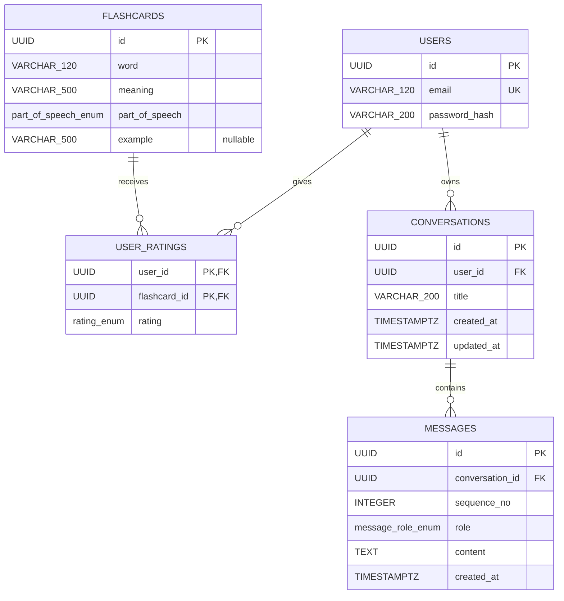

# Architecture

This document describes a target design of an application.

## 1. Design requirements

### Functional requirements

- Users can register with a valid email and matching passwords (minimum 8 characters), log in, and retrieve their own profile.
- Authenticated users can browse flashcards, filter by word, meaning, part of speech, and their own rating, sort by word, and paginate results.
- Authenticated users can create or change their rating for a flashcard.
- Authenticated users can request a learning session of up to 10 flashcards, selected by rating priority: hard, medium, easy, then unrated.
- Authenticated users can learn with AI powered Tutor through chat view. 
- AI powered Tutor has knowledge about Flashcards ratings that user left and uses this data in chat.
- AI powered Tutor can create new Flashcards basing on conversation with user.

### Non-functional requirements

- Reliability:
    * `GET /healthcheck` returns HTTP 503 when the database check fails.
- Security:
    * Vulnerabilities checks in pipelines

## 2. Data model

| Table | Column | Database type | Constraints |
|---|---|---|---|
| `users` | `id` | UUID | PK |
| `users` | `email` | VARCHAR(120) | NOT NULL, UNIQUE |
| `users` | `password_hash` | VARCHAR(200) | NOT NULL |
| `flashcards` | `id` | UUID | PK |
| `flashcards` | `word` | VARCHAR(120) | NOT NULL |
| `flashcards` | `meaning` | VARCHAR(500) | NOT NULL |
| `flashcards` | `part_of_speech` | ENUM `part_of_speech_enum` | NOT NULL |
| `flashcards` | `example` | VARCHAR(500) | NULL |
| `user_ratings` | `user_id` | UUID | PK, FK → `users.id` |
| `user_ratings` | `flashcard_id` | UUID | PK, FK → `flashcards.id` |
| `user_ratings` | `rating` | ENUM `rating_enum` | NOT NULL |
| `conversations` | `id` | UUID | PK |
| `conversations` | `user_id` | UUID | NOT NULL, FK → `users.id` |
| `conversations` | `title` | VARCHAR(200) | NULL |
| `conversations` | `created_at` | TIMESTAMPTZ | NOT NULL |
| `conversations` | `updated_at` | TIMESTAMPTZ | NOT NULL |
| `messages` | `id` | UUID | PK |
| `messages` | `conversation_id` | UUID | NOT NULL, FK → `conversations.id` |
| `messages` | `sequence_no` | INTEGER | NOT NULL; unique with `conversation_id` |
| `messages` | `role` | ENUM `message_role_enum` | NOT NULL |
| `messages` | `content` | TEXT | NOT NULL |
| `messages` | `created_at` | TIMESTAMPTZ | NOT NULL |

`message_role_enum` should initially contain `USER` and `ASSISTANT`. `sequence_no` provides deterministic message ordering within a conversation and should have a unique constraint together with `conversation_id`. The foreign keys associate each conversation with its owner and each message with its conversation; cascading deletion can be used so deleting a conversation also deletes its messages.



## 3. API design

All paths below are relative to the API base URL configured by `VITE_API_URL`. Endpoints other than registration, login, and health check require an access JWT in the standard HTTP authorization header. Requests and responses are JSON unless stated otherwise. Successful response examples show the response body, not the HTTP status.

| Method and path | Authentication | Request | Success response |
|---|---|---|---|
| `POST /auth/register` | Public | JSON: `{"email":"learner@example.com","password_1":"...","password_2":"..."}` | `201`; `{"id":"<uuid>","email":"learner@example.com"}` |
| `POST /auth/login` | Public | Form URL-encoded OAuth2 fields `username` (email) and `password` | `200`; `{"access_token":"<jwt>","token_type":"bearer"}` |
| `GET /auth/me` | JWT required | None | `200`; `{"id":"<uuid>","email":"learner@example.com"}` |
| `GET /flashcards/` | JWT required | Query parameters below | `200`; paginated flashcard response below |
| `POST /flashcards/{flashcard_id}` | JWT required | JSON: `{"rating":1}` (`1` easy, `2` medium, `3` hard) | `201`; `{"rating_changed":true}` or `{"rating_changed":false}` |
| `GET /flashcards/learning_session/` | JWT required | None | `200`; array of flashcards, possibly empty |
| `GET /healthcheck` | Public | None | `200`; `{"status":"healthy"}` |

Flashcard-list query parameters:

| Parameter | Type and behavior |
|---|---|
| `page` | Integer, default `1`, minimum `1` |
| `page_size` | Integer, default `10`, range `1`–`50` |
| `order_by` | Optional `word` or `-word` (ascending or descending) |
| `word`, `meaning` | Optional string filter; substring match by default, surround a value with double quotes for exact match |
| `part_of_speech` | Optional `part_of_speech_enum` value |
| `rating` | Optional integer: `0` not rated, `1` easy, `2` medium, `3` hard |

Paginated response:

```json
{
  "items": [
    {
      "id": "<uuid>",
      "word": "example",
      "meaning": "przykład",
      "part_of_speech": "noun",
      "example": "This is an example.",
      "rating": 1
    }
  ],
  "total": 1,
  "page": 1,
  "page_size": 10,
  "total_pages": 1,
  "has_next": false,
  "has_previous": false
}
```

`example` and `rating` may be `null`; `rating` is the requesting user's rating. An empty result has an empty `items` array and zero `total`/`total_pages`.

Common error behavior: invalid input is rejected by FastAPI with `422`; missing/invalid credentials produce `401`; `/auth/me` returns `404` if the token refers to a user that no longer exists. Registration also returns `400` when the email already exists or passwords do not match. Health check returns `503` with `{"detail":"Database unavailable"}` when the database cannot be reached. Other failures are not exhaustively specified here.

## 4. High-level system architecture

```mermaid
flowchart LR
    User[User]
    Browser[Browser: React SPA]
    Axios[Shared Axios client]
    subgraph API["FastAPI API"]
        Request[HTTP request]
        Auth[Authentication and authorization<br/>OAuth2 bearer JWT dependency]
        Public["Public endpoints<br/>register, login, health check"]
        Protected["Protected endpoints<br/>auth me, flashcards"]
        Services[Feature services]
        Request -->|public routes| Public
        Request --> Auth
        Auth -->|valid bearer token| Protected
        Public --> Services
        Protected --> Services
    end
    DBAccess[Async SQLAlchemy]
    Database[(PostgreSQL-compatible database)]
    LocalDB[PostgreSQL container]
    DatabricksDB[Databricks database endpoint]
    Migrations[Alembic migrations]
    Echo[In-browser echo adapter<br/>sample chat data]

    User --> Browser
    Browser -->|HTTP JSON; login uses form URL encoding| Axios
    Axios -->|HTTP| API
    Services --> DBAccess
    DBAccess -->|PostgreSQL protocol over configured connection| Database
    Migrations -->|schema changes| Database
    Database -. local ENV .-> LocalDB
    Database -. databricks ENV .-> DatabricksDB
    Browser -->|local only; no API request| Echo
```



The bearer-token dependency is implemented inside the FastAPI backend; it is shown as a component to make the protected-route boundary explicit, not as a separate gateway or authentication service. Registration and login are public routes; flashcard routes and `/auth/me` require a valid token, which the backend verifies and resolves to a user in the database. The health check is public.

The current client is the browser SPA only; there is no separate mobile client. Client-to-API communication uses HTTP (JSON for API payloads, except URL-encoded login form data). No WebSocket API is implemented. The API uses PostgreSQL connections; the selected database target is local PostgreSQL or a Databricks database endpoint according to backend configuration. No S3/object storage or Redis dependency is currently wired into the application. The chat echo adapter runs in the browser. OpenAI configuration and LangChain packages exist in the backend, but there is no implemented API-to-LLM request flow.

## Component details

### Frontend

`frontend/src/App.tsx` composes routes and shared providers. Feature code lives under `auth`, `chat`, and `flashcards`; shared pages, navigation, state, theme, and API handling live under `core`.

- Authentication pages use feature services to register and log in. The login service stores the returned bearer token in local storage.
- The shared Axios client uses `VITE_API_URL` as its base URL and adds the stored token to non-authentication requests.
- Flashcards support server-side filtering, sorting, and pagination, user-specific ratings, and a learning-session modal.
- Chat uses `createEchoAdapter()` and sample conversations from `frontend/src/chat/pages/testData.ts`.

### Backend and persistence

`backend/src/main.py` mounts the core, auth, and flashcards routers. Feature services implement application behavior; routes use Pydantic schemas and the shared async database-session dependency. Alembic migrations manage the schema; seed flashcard data is in `backend/src/alembic/`.

Backend settings require `ENV`. `local` builds a PostgreSQL connection using `PG*` settings; `databricks` obtains a database token through the Databricks SDK and requires SSL.
