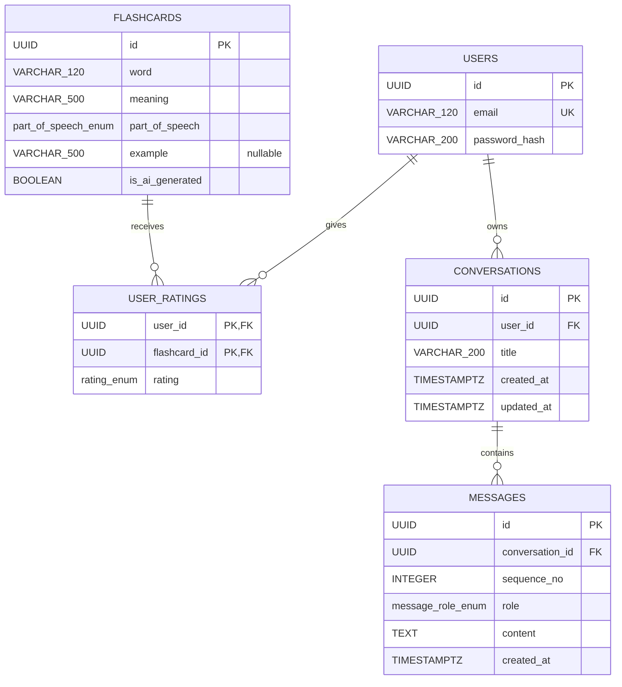
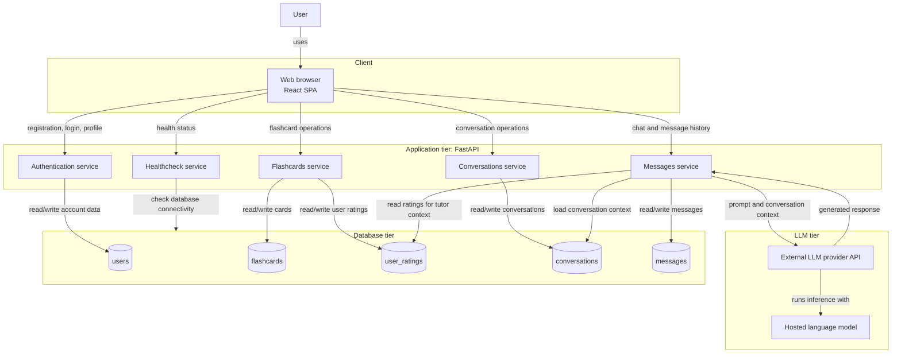
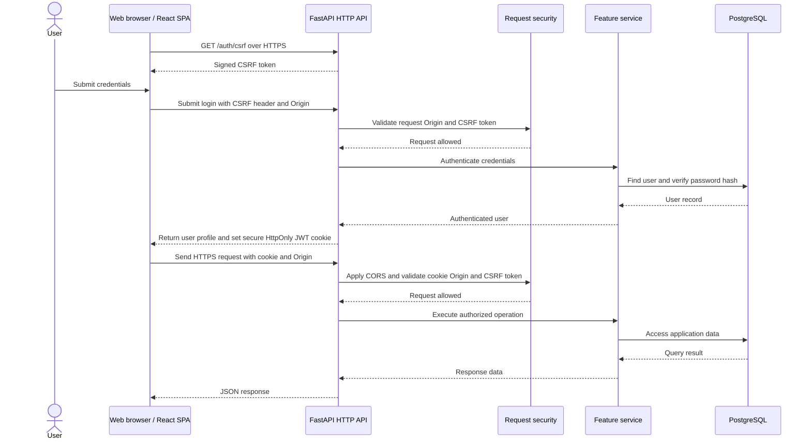
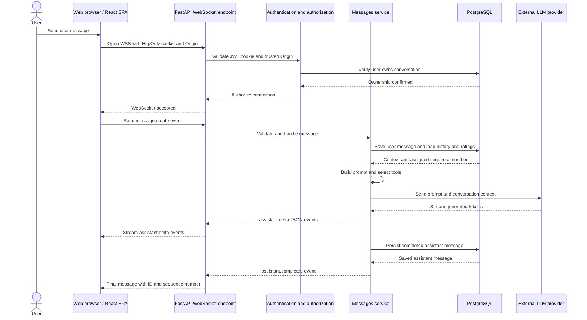

# Architecture

This document describes a target design of an application.

## 1. Design requirements

### Functional requirements

- Users can register with a valid email and matching passwords (minimum 8 characters), log in, and retrieve their own profile.
- Authenticated users can browse flashcards, filter by word, meaning, part of speech, and their own rating, sort by word, and paginate results.
- Authenticated users can create or change their rating for a flashcard.
- Authenticated users can request a learning session of up to 10 flashcards, selected by rating priority: hard, medium, easy, then unrated.
- Authenticated users can learn with AI powered Tutor through chat view. 
- AI powered Tutor has knowledge about Flashcards ratings that user left and uses this data in chat.
- The AI-powered Tutor automatically creates flashcards from conversation when appropriate. AI-generated flashcards are shared in the flashcard catalog and marked as AI-generated.

### Non-functional requirements

- Reliability:
    * `GET /healthcheck` returns HTTP 503 when the database check fails.
- Security:
    * Protect user data and state-changing operations against unauthorized access and cross-site request forgery.
    * Restrict cross-origin browser access to explicitly trusted frontend origins.
    * Encrypt HTTP API and WebSocket traffic in deployed environments.
    * Include automated vulnerability checks in the delivery pipeline.

## 2. Data model

### Users (`users`)

| Column | Database type | Constraints |
|---|---|---|
| `id` | UUID | PK |
| `email` | VARCHAR(120) | NOT NULL, UNIQUE |
| `password_hash` | VARCHAR(200) | NOT NULL |

### Flashcards (`flashcards`)

| Column | Database type | Constraints |
|---|---|---|
| `id` | UUID | PK |
| `word` | VARCHAR(120) | NOT NULL |
| `meaning` | VARCHAR(500) | NOT NULL |
| `part_of_speech` | ENUM `part_of_speech_enum` | NOT NULL |
| `example` | VARCHAR(500) | NULL |
| `is_ai_generated` | BOOLEAN | NOT NULL; default `false` |

Flashcards are shared catalog entries and are not owned by individual users. The server sets `is_ai_generated` to `true` when the tutor creates a card; clients cannot set or change this flag. User ratings remain separate and user-specific in `user_ratings`.

`part_of_speech_enum` values (database label → API value):

| Database enum value | API value |
|---|---|
| `NOUN` | `noun` |
| `VERB` | `verb` |
| `ADJECTIVE` | `adjective` |
| `ADVERB` | `adverb` |
| `PRONOUN` | `pronoun` |
| `PREPOSITION` | `preposition` |
| `CONJUNCTION` | `conjunction` |
| `INTERJECTION` | `interjection` |
| `NUMERAL` | `numeral` |
| `PROPER_NOUN` | `proper noun` |

### User ratings (`user_ratings`)

| Column | Database type | Constraints |
|---|---|---|
| `user_id` | UUID | PK, FK → `users.id` |
| `flashcard_id` | UUID | PK, FK → `flashcards.id` |
| `rating` | ENUM `rating_enum` | NOT NULL |

The composite primary key `(user_id, flashcard_id)` allows at most one rating per user for each flashcard.

`rating_enum` values (database enum label → API value):

| Database enum value | API value |
|---|---|
| `EASY` | `1` |
| `MEDIUM` | `2` |
| `HARD` | `3` |

The flashcard-list `rating` filter additionally accepts `0` to mean not rated; `0` is a filter option and is not stored in `user_ratings`.

### Conversations (`conversations`)

| Column | Database type | Constraints |
|---|---|---|
| `id` | UUID | PK |
| `user_id` | UUID | NOT NULL, FK → `users.id` |
| `title` | VARCHAR(200) | NULL |
| `created_at` | TIMESTAMPTZ | NOT NULL |
| `updated_at` | TIMESTAMPTZ | NOT NULL |

Each conversation belongs to one user.

### Messages (`messages`)

| Column | Database type | Constraints |
|---|---|---|
| `id` | UUID | PK |
| `conversation_id` | UUID | NOT NULL, FK → `conversations.id` |
| `sequence_no` | INTEGER | NOT NULL; unique with `conversation_id` |
| `role` | ENUM `message_role_enum` | NOT NULL |
| `content` | TEXT | NOT NULL |
| `created_at` | TIMESTAMPTZ | NOT NULL |

`message_role_enum` values:

| Enum value | Meaning |
|---|---|
| `USER` | Message written by the user |
| `ASSISTANT` | Response written by the AI tutor |

`sequence_no` provides deterministic message ordering within a conversation and has a unique constraint together with `conversation_id`. Deleting a conversation cascades to its messages.

### Relationships

The diagram shows the relationships between the data models. In particular, `user_ratings.user_id` and `conversations.user_id` reference `users.id`, and `messages.conversation_id` references `conversations.id`.



## 3. API design

HTTP paths below are relative to the API base URL configured by `VITE_API_URL`. HTTP request and response bodies use JSON unless stated otherwise. The chat message transport uses a WebSocket JSON event protocol described separately.

### Healthcheck

The healthcheck endpoint is public and verifies database connectivity.

| Method and path | Authentication | Request | Success response |
|---|---|---|---|
| `GET /healthcheck` | Public | None | `200`; `{"status":"healthy"}` |

If the database cannot be reached, it returns `503` with `{"detail":"Database unavailable"}`.

### Authentication

Registration and login are public HTTP endpoints. A successful login sets a signed access JWT with a 15-minute lifetime in an `HttpOnly`, `Secure`, `SameSite=Lax` cookie scoped to `/`, with no `Domain` attribute and a matching cookie expiry; the token is not returned to frontend JavaScript. The same cookie authenticates protected HTTPS endpoints and WSS handshakes. For each protected HTTP request and WSS handshake, the API validates the JWT signature, allowed signing algorithm, issuer, audience, and expiry. The JWT `sub` claim contains the authenticated user's UUID; the API resolves it to a user record and rejects the credential if that user does not exist. Resource authorization compares the authenticated user's ID with the owner ID of the requested resource. Logout clears the browser cookie; an issued JWT remains valid until expiry, including on already-established WebSocket connections.

Unsafe HTTP requests require a valid CSRF token in the `X-CSRF-Token` header and a trusted `Origin`. Credentialed CORS requests are allowed only from explicitly configured frontend origins.

| Method and path | Authentication | Request | Success response |
|---|---|---|---|
| `GET /auth/csrf` | Public | None | `200`; `{"csrf_token":"<signed-csrf-token>"}` |
| `POST /auth/register` | Public; CSRF token required | JSON: `{"email":"learner@example.com","password_1":"...","password_2":"..."}` and `X-CSRF-Token` header | `201`; `{"id":"<uuid>","email":"learner@example.com"}` |
| `POST /auth/login` | Public; CSRF token required | Form URL-encoded OAuth2 fields `username` (email) and `password`, plus `X-CSRF-Token` header | `200`; `{"id":"<uuid>","email":"learner@example.com"}` and `Set-Cookie` for the access JWT |
| `POST /auth/logout` | Access JWT cookie; CSRF token required | `X-CSRF-Token` header | `204`; clears the cookie |
| `GET /auth/me` | Access JWT cookie required | None | `200`; `{"id":"<uuid>","email":"learner@example.com"}` |

Invalid input is rejected with `422`; missing, expired, or invalid JWTs produce `401`. Invalid/missing CSRF tokens or untrusted origins are rejected with `403`. Registration also returns `400` if the email already exists or the passwords do not match. `/auth/me` returns `404` if the JWT refers to a user that no longer exists.

`GET /auth/csrf` issues a cryptographically signed CSRF token for the frontend to retain in memory and send as `X-CSRF-Token`; the frontend never reads the JWT cookie. The backend validates the token and checks `Origin` for unsafe HTTP requests. Login and registration are also CSRF-protected to prevent login CSRF.

### Flashcards

All flashcard endpoints require the access JWT cookie. State-changing requests also require a valid CSRF token in `X-CSRF-Token`.

| Method and path | Request | Success response |
|---|---|---|
| `GET /flashcards/` | Query parameters below | `200`; paginated flashcard response below |
| `POST /flashcards/{flashcard_id}` | JSON: `{"rating":1}` (`1` easy, `2` medium, `3` hard) | `201`; `{"rating_changed":true}` or `{"rating_changed":false}` |
| `GET /flashcards/learning_session/` | None | `200`; array of flashcards, possibly empty |

#### Flashcard-list query parameters

| Parameter | Type and behavior |
|---|---|
| `page` | Integer, default `1`, minimum `1` |
| `page_size` | Integer, default `10`, range `1`–`50` |
| `order_by` | Optional `word` or `-word` (ascending or descending) |
| `word`, `meaning` | Optional string filter; substring match by default, surround a value with double quotes for exact match |
| `part_of_speech` | Optional `part_of_speech_enum` value |
| `rating` | Optional integer: `0` not rated, `1` easy, `2` medium, `3` hard |

`GET /flashcards/` paginated response:

```json
{
  "items": [
    {
      "id": "<uuid>",
      "word": "example",
      "meaning": "przykład",
      "part_of_speech": "noun",
      "example": "This is an example.",
      "rating": 1,
      "is_ai_generated": false
    }
  ],
  "total": 1,
  "page": 1,
  "page_size": 10,
  "total_pages": 1,
  "has_next": false,
  "has_previous": false
}
```

`example` and `rating` may be `null`; `rating` is the requesting user's rating. `is_ai_generated` indicates whether the card was created by the tutor. An empty result has an empty `items` array and zero `total`/`total_pages`.

Invalid input is rejected with `422`; missing or invalid credentials produce `401`. Other failure responses are not exhaustively specified here.

### Conversations

These endpoints manage conversations owned by the authenticated user. All endpoints require the access JWT cookie and only expose conversations belonging to that user. `POST`also requires a valid CSRF token in `X-CSRF-Token`.

| Method and path | Parameters / example request | Example success response |
|---|---|---|
| `GET /conversations` | Query: `page` (default `1`), `page_size` (default `20`, maximum `100`). Example: `/conversations?page=1&page_size=20` | `200`; paginated conversation summaries (example below) |
| `POST /conversations` | JSON: `{"title":"English practice"}`; `title` may be omitted or `null` | `201`; created conversation (example below) |
| `GET /conversations/{conversation_id}` | Path: `conversation_id` UUID. Example: `/conversations/550e8400-e29b-41d4-a716-446655440000` | `200`; conversation object |

Paginated list response:

```json
{
  "items": [
    {
      "id": "550e8400-e29b-41d4-a716-446655440000",
      "title": "English practice",
      "created_at": "2026-10-24T08:30:00Z",
      "updated_at": "2026-10-24T08:35:00Z"
    }
  ],
  "total": 1,
  "page": 1,
  "page_size": 20,
  "total_pages": 1,
  "has_next": false,
  "has_previous": false
}
```

Create, retrieve, and update response:

```json
{
  "id": "550e8400-e29b-41d4-a716-446655440000",
  "title": "English practice",
  "created_at": "2026-10-24T08:30:00Z",
  "updated_at": "2026-10-24T08:30:00Z"
}
```

### Messages

Message history is fetched over HTTP using the JWT cookie. Sending a message and receiving the AI response use a WebSocket connection scoped to one conversation. The browser automatically sends the same JWT cookie during the handshake. The server validates the JWT and trusted `Origin` before accepting the connection; it then assigns `sequence_no`, `role`, and `created_at`. Clients cannot choose a role or write directly as the assistant. Logging out clears the browser cookie but does not invalidate an already-issued JWT. Established WebSocket connections are closed when their JWT expires.

| Method and path | Parameters / example request | Example success response |
|---|---|---|
| `GET /conversations/{conversation_id}/messages` | Path: `conversation_id` UUID. Query: `page` (default `1`), `page_size` (default `50`, maximum `100`). Example: `/conversations/550e8400-e29b-41d4-a716-446655440000/messages?page=1&page_size=50`. Results ordered by `sequence_no` ascending. | `200`; paginated message list (example below) |

Paginated message-list response:

```json
{
  "items": [
    {
      "id": "7d444840-9dc0-11d1-b245-5ffdce74fad2",
      "conversation_id": "550e8400-e29b-41d4-a716-446655440000",
      "sequence_no": 1,
      "role": "USER",
      "content": "Can you explain the past tense?",
      "created_at": "2026-10-24T08:35:00Z"
    },
    {
      "id": "7d444840-9dc0-11d1-b245-5ffdce74fad3",
      "conversation_id": "550e8400-e29b-41d4-a716-446655440000",
      "sequence_no": 2,
      "role": "ASSISTANT",
      "content": "The past tense describes an action that happened before now.",
      "created_at": "2026-10-24T08:35:02Z"
    }
  ],
  "total": 2,
  "page": 1,
  "page_size": 50,
  "total_pages": 1,
  "has_next": false,
  "has_previous": false
}
```

#### WebSocket message exchange

1. The client opens `wss://<api-host>/ws/conversations/{conversation_id}`. The browser automatically includes the JWT cookie and the `Origin` header in the handshake.
2. Before `websocket.accept()`, the server validates the JWT signature and claims, checks that it is unexpired, checks that `Origin` exactly matches a configured trusted frontend origin, and verifies that the authenticated user owns the conversation. Invalid credentials, origins, or ownership are rejected before upgrade. No JWT or ticket is put in the URL. An established socket is not terminated by logout but is closed when its JWT expires.
3. The client sends a JSON event:

```json
{
  "type": "message.create",
  "content": "Can you explain the past tense?"
}
```

4. The server persists the user message, sends the relevant conversation history and flashcard ratings to the AI model, and streams the response as JSON events. When the tutor creates a flashcard, the server validates and persists it in the shared catalog with `is_ai_generated=true`; the operation does not require a separate user confirmation. On completion it persists the assistant message. `sequence_no` is assigned by the server.

Example server events:

```json
{"type":"message.accepted","message":{"id":"<uuid>","conversation_id":"<uuid>","sequence_no":1,"role":"USER","content":"Can you explain the past tense?","created_at":"2026-10-24T08:35:00Z"}}
{"type":"assistant.delta","message_id":"<uuid>","delta":"The past tense "}
{"type":"assistant.delta","message_id":"<uuid>","delta":"describes an action that happened before now."}
{"type":"assistant.completed","message":{"id":"<uuid>","conversation_id":"<uuid>","sequence_no":2,"role":"ASSISTANT","content":"The past tense describes an action that happened before now.","created_at":"2026-10-24T08:35:02Z"}}
```

Application errors are sent as `{"type":"error","code":"<error-code>","message":"<description>"}`. The socket is closed when the connection is unauthorized, the origin is untrusted, the conversation is unavailable to the user, or the client sends an invalid event.

For HTTP conversation and message-history endpoints, invalid input returns `422`, unauthenticated requests return `401`, a missing resource or a resource owned by another user returns `404`, and an invalid CSRF token or untrusted origin returns `403`. WebSocket authentication, origin, and ownership failures are rejected during the handshake; invalid events produce an error event and close the socket.

## 4. High-level system architecture



This diagram shows the application components and their data dependencies. HTTPS and WSS flows are detailed below.

### HTTPS request flow



### WSS chat flow


