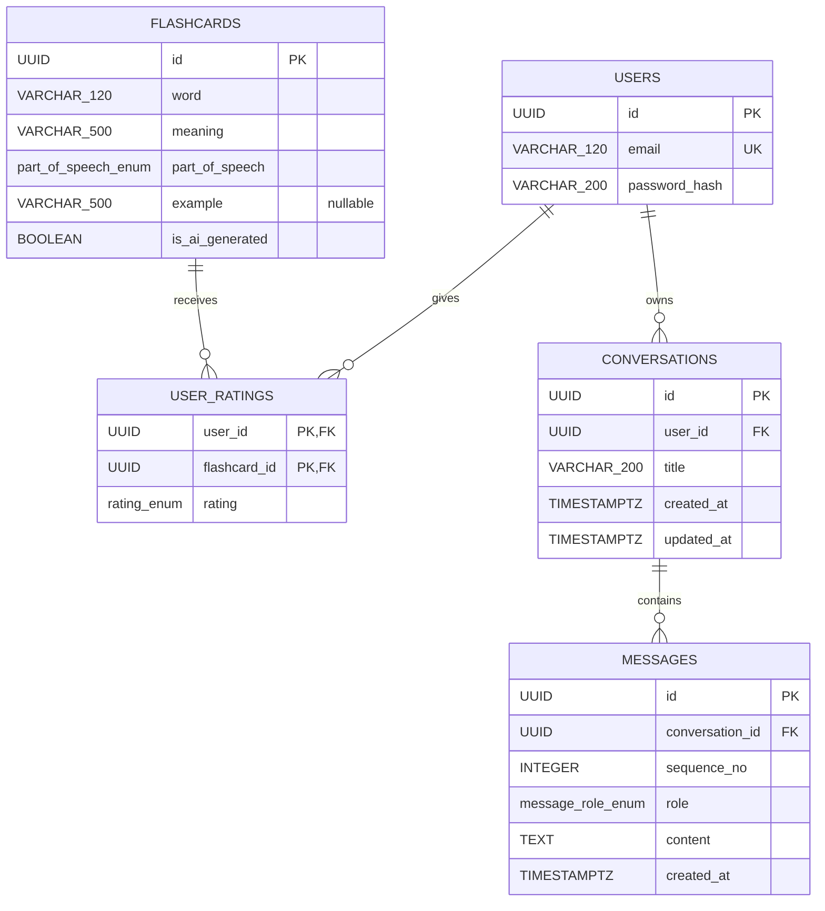
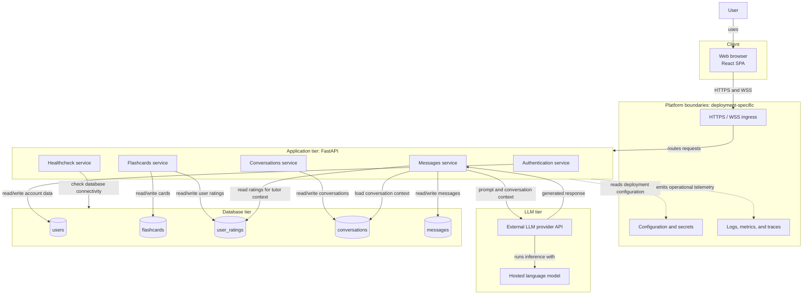
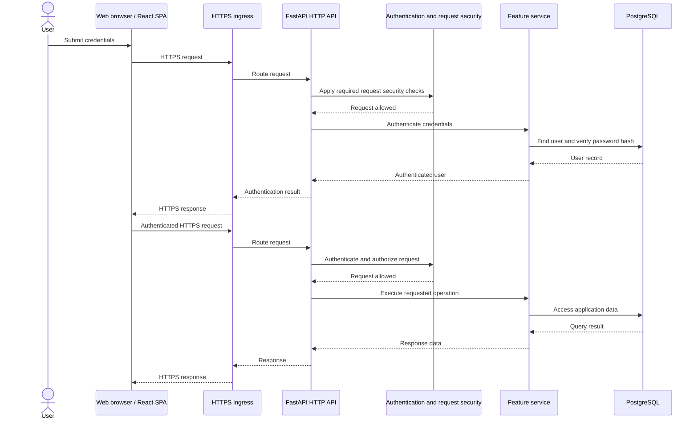
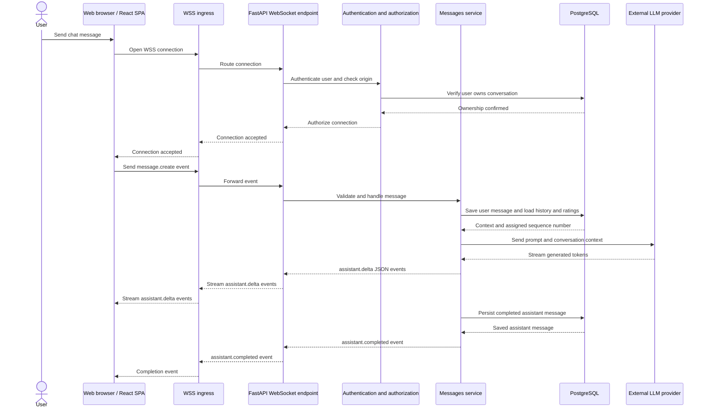

# Architecture

This document describes a target design of an application.
It establishes the domain and service boundaries; implementation choices not specified here are settled during development and recorded in ADRs when appropriate.

## 1. Design requirements

### Functional requirements

- Users can register with a valid email and matching passwords (minimum 8 characters), log in, and retrieve their own profile.
- Authenticated users can browse flashcards, filter by word, meaning, part of speech, and their own rating, sort by word, and paginate results.
- Authenticated users can create or change their rating for a flashcard.
- Authenticated users can request a learning session of up to 10 flashcards, selected by rating priority: hard, medium, easy, then unrated.
- Authenticated users can learn with an AI-powered tutor through chat.
- The AI-powered tutor can use the user's flashcard ratings as relevant learning context.
- The AI-powered tutor automatically creates flashcards from conversation when appropriate. AI-generated flashcards are shared in the flashcard catalog and marked as AI-generated.

### Non-functional requirements

- Security: Protect accounts and user data from unauthorized access, protect browser state-changing operations against CSRF, restrict browser access to trusted frontend origins, and protect data in transit.
- Privacy and data handling: Minimize personal data shared with external services, make its use and retention transparent to users, and do not allow user data to be used for model training.
- Reliability and availability: Keep core learning and chat flows dependable, surface failures clearly, and report when required dependencies are unavailable.
- Performance: Keep interactive learning and chat responsive as the application grows.
- Accessibility: Make core user journeys usable with a range of input methods and assistive technologies.
- Observability and operations: Provide enough operational visibility to detect and diagnose failures without exposing credentials or sensitive user content.
- Scale and capacity: Support growth in users, flashcards, and conversations without assuming a fixed deployment size.
- Delivery quality: Use automated tests and security checks to catch regressions and vulnerable dependencies.

Specific service-level targets and implementation mechanisms are intentionally left open for development and may be recorded in ADRs when decided.

## 2. Data model

### Users (`users`)

| Column | Database type | Constraints |
|---|---|---|
| `id` | UUID | PK |
| `email` | VARCHAR(120) | NOT NULL, UNIQUE |
| `password_hash` | VARCHAR(200) | NOT NULL |

### Flashcards (`flashcards`)

| Column | Database type | Constraints |
|---|---|---|
| `id` | UUID | PK |
| `word` | VARCHAR(120) | NOT NULL |
| `meaning` | VARCHAR(500) | NOT NULL |
| `part_of_speech` | ENUM `part_of_speech_enum` | NOT NULL |
| `example` | VARCHAR(500) | NULL |
| `is_ai_generated` | BOOLEAN | NOT NULL; default `false` |

Flashcards are shared catalog entries and are not owned by individual users. The server sets `is_ai_generated` to `true` when the tutor creates a card; clients cannot set or change this flag. User ratings remain separate and user-specific in `user_ratings`.

`part_of_speech_enum` values (database label → API value):

| Database enum value | API value |
|---|---|
| `NOUN` | `noun` |
| `VERB` | `verb` |
| `ADJECTIVE` | `adjective` |
| `ADVERB` | `adverb` |
| `PRONOUN` | `pronoun` |
| `PREPOSITION` | `preposition` |
| `CONJUNCTION` | `conjunction` |
| `INTERJECTION` | `interjection` |
| `NUMERAL` | `numeral` |
| `PROPER_NOUN` | `proper noun` |

### User ratings (`user_ratings`)

| Column | Database type | Constraints |
|---|---|---|
| `user_id` | UUID | PK, FK → `users.id` |
| `flashcard_id` | UUID | PK, FK → `flashcards.id` |
| `rating` | ENUM `rating_enum` | NOT NULL |

The composite primary key `(user_id, flashcard_id)` allows at most one rating per user for each flashcard.

`rating_enum` values (database label → API value):

| Database enum value | API value |
|---|---|
| `EASY` | `1` |
| `MEDIUM` | `2` |
| `HARD` | `3` |

The flashcard-list `rating` filter additionally accepts `0` to mean not rated; `0` is a filter option and is not stored in `user_ratings`.

### Conversations (`conversations`)

| Column | Database type | Constraints |
|---|---|---|
| `id` | UUID | PK |
| `user_id` | UUID | NOT NULL, FK → `users.id` |
| `title` | VARCHAR(200) | NULL |
| `created_at` | TIMESTAMPTZ | NOT NULL |
| `updated_at` | TIMESTAMPTZ | NOT NULL |

Each conversation belongs to one user.

### Messages (`messages`)

| Column | Database type | Constraints |
|---|---|---|
| `id` | UUID | PK |
| `conversation_id` | UUID | NOT NULL, FK → `conversations.id` |
| `sequence_no` | INTEGER | NOT NULL; unique with `conversation_id` |
| `role` | ENUM `message_role_enum` | NOT NULL |
| `content` | TEXT | NOT NULL |
| `created_at` | TIMESTAMPTZ | NOT NULL |

`message_role_enum` values:

| Enum value | Meaning |
|---|---|
| `USER` | Message written by the user |
| `ASSISTANT` | Response written by the AI tutor |

`sequence_no` provides deterministic message ordering within a conversation and has a unique constraint together with `conversation_id`. Deleting a conversation cascades to its messages.

### Relationships

The diagram shows the relationships between the domain models.

## 3. API design

HTTP paths are relative to the API base URL. Examples illustrate the expected contract; fields not relevant to the example are omitted. Authenticated endpoints require a valid user credential, and each user may access only their own profile, ratings, conversations, and messages.

### Healthcheck Service

| Endpoint | Goal | Example request | Example response |
|---|---|---|---|
| `GET /healthcheck` | Check application availability and database connectivity. | `GET /healthcheck` | `200` `{"status":"healthy"}`; database failure returns `503`. |

### Authentication Service

| Endpoint | Goal | Example request | Example response |
|---|---|---|---|
| `GET /auth/csrf` | Obtain the browser CSRF token. | `GET /auth/csrf` | `200` `{"csrf_token":"<token>"}` |
| `POST /auth/register` | Create an account. | JSON `{"email":"learner@example.com","password_1":"...","password_2":"..."}` | `201` `{"id":"<uuid>","email":"learner@example.com"}` |
| `POST /auth/login` | Authenticate an account. | Form fields `username` (email) and `password`. | `200` `{"id":"<uuid>","email":"learner@example.com"}`; establishes the authenticated browser session. |
| `POST /auth/logout` | End the browser session. | `POST /auth/logout` | `204` no response body |
| `GET /auth/me` | Retrieve the authenticated user's profile. | `GET /auth/me` | `200` `{"id":"<uuid>","email":"learner@example.com"}` |

The accepted target uses an HttpOnly cookie for the access token, with CSRF protection for unsafe requests and trusted-origin checks; see [ADR 0002](decisions/0002-cookie-based-authentication.md). The current backend still returns a bearer token, so this target requires a frontend and backend migration.

### Flashcards Service

| Endpoint | Goal | Example request | Example response |
|---|---|---|---|
| `GET /flashcards/` | Browse, filter, sort, and paginate the shared catalog; each card includes the requesting user's rating. | `GET /flashcards/?word=example&page=1&page_size=10` | `200` `{"items":[{"id":"<uuid>","word":"example","meaning":"przykład","part_of_speech":"noun","example":"This is an example.","rating":1,"is_ai_generated":false}],"total":1,"page":1,"page_size":10}` |
| `POST /flashcards/{flashcard_id}` | Create or change the current user's rating. | `POST /flashcards/550e8400-e29b-41d4-a716-446655440000` with JSON `{"rating":1}` | `201` `{"rating_changed":true}` |
| `GET /flashcards/learning_session/` | Return up to 10 cards, prioritizing hard, medium, easy, then unrated cards. | `GET /flashcards/learning_session/` | `200` `[{"id":"<uuid>","word":"example","meaning":"przykład","part_of_speech":"noun","example":null,"rating":3}]` |

The list filters are `word`, `meaning`, `part_of_speech`, and `rating`; sorting is supported by word. Rating filter value `0` means not rated; stored ratings are `1` (easy), `2` (medium), and `3` (hard). Pagination and filtering validation details are finalized during implementation.

### Conversations Service

| Endpoint | Goal | Example request | Example response |
|---|---|---|---|
| `GET /conversations` | List the authenticated user's conversations. | `GET /conversations?page=1&page_size=20` | `200` `{"items":[{"id":"<uuid>","title":"English practice","created_at":"2026-10-24T08:30:00Z","updated_at":"2026-10-24T08:35:00Z"}],"total":1,"page":1,"page_size":20}` |
| `POST /conversations` | Create a conversation. | JSON `{"title":"English practice"}` | `201` `{"id":"<uuid>","title":"English practice","created_at":"2026-10-24T08:30:00Z","updated_at":"2026-10-24T08:30:00Z"}` |
| `GET /conversations/{conversation_id}` | Retrieve a conversation owned by the authenticated user. | `GET /conversations/550e8400-e29b-41d4-a716-446655440000` | `200` `{"id":"<uuid>","title":"English practice","created_at":"2026-10-24T08:30:00Z","updated_at":"2026-10-24T08:30:00Z"}` |

### Messages Service

| Endpoint | Goal | Example request | Example response |
|---|---|---|---|
| `GET /conversations/{conversation_id}/messages` | Retrieve ordered history for a conversation owned by the authenticated user. | `GET /conversations/550e8400-e29b-41d4-a716-446655440000/messages?page=1&page_size=50` | `200` `{"items":[{"id":"<uuid>","sequence_no":1,"role":"USER","content":"Can you explain the past tense?","created_at":"2026-10-24T08:35:00Z"}],"total":1,"page":1,"page_size":50}` |
| `WSS /conversations/{conversation_id}/ws` | Exchange chat messages and stream the tutor response for one owned conversation. | Connect to `wss://<api-host>/conversations/<conversation_id>/ws`; send `{"type":"message.create","content":"Can you explain the past tense?"}` | Server streams `{"type":"assistant.delta","content":"The past tense..."}` and completes with `{"type":"assistant.completed","message":{"id":"<uuid>","sequence_no":2,"role":"ASSISTANT","content":"The past tense describes an action that happened before now."}}`. |

WebSocket events also include `error` for connection or message-processing failures. The server assigns message roles and ordering; clients cannot write as the tutor. Completed tutor messages are persisted. The server sends only relevant conversation context and rating information to the external LLM provider. Before first use, users are informed of this data sharing; the provider must not use submitted data for model training and may retain it only as needed for service operation or abuse prevention.

Exact validation limits, error codes, pagination defaults, and WebSocket failure/retry behavior are settled during implementation and recorded in ADRs when they represent significant architectural decisions.

## 4. High-level system architecture

The LLM provider is the only external runtime integration currently assumed. The platform boxes mark deployment boundaries without selecting products or a hosting topology; Redis and object storage are not assumed. HTTPS and WSS flows are detailed below.

### HTTPS request flow

### WSS chat flow

